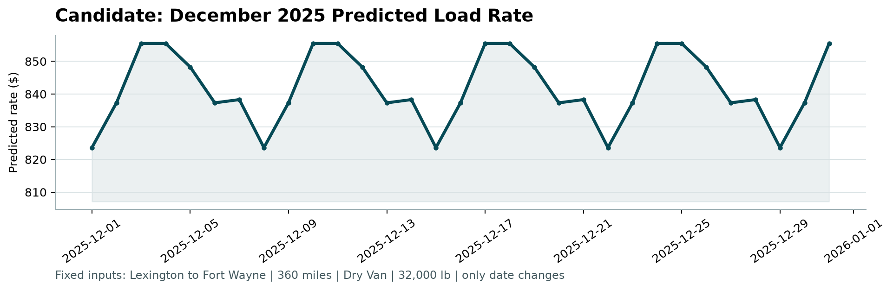

# Freight Rate Prediction Challenge - Report Draft

## Problem

Predict each load's posted freight rate from information available before the rate is known. The final deliverables are 12,000 validation predictions and a December 2025 fixed-lane rate chart. The provided scorer checks output structure and produces the chart; Spotter calculates the final hidden validation metric after submission.

## Data exploration

- The labeled development file contains 48,000 loads dated January 1 through October 31, 2025. The 12,000 unlabeled validation loads cover November 1 through December 31, 2025. The target is `posted_rate`.
- Distance is the strongest simple predictor. Equipment, origin, destination, lane, and date also matter. The training data has 64 origin/destination cities; validation introduces eight additional cities.
- Training has 300 missing weights, 374 missing market-index values, and 292 negative weights (0.608%). Negative freight weights are implausible, but keeping them produced the best chronological validation MAE of the treatments tested.
- The target is right-skewed: mean $2,373.98, median $2,030.76, and maximum $25,533. Very high-rate loads are rare and difficult to predict.
- The final model uses only inputs available in all three datasets: pickup, delivery, distance, equipment, weight, and date. It derives month, Monday-based week of year, day of week, and forward/reverse lane counts. Lane counts are fitted using training rows only. The December input does not provide coordinates, market index, or quote signal.

<!-- PAGE BREAK -->

## Validation strategy

Chronological validation matches the November-December forecast better than random splitting, which would mix market periods and repeated lanes. Learned preprocessing and lane counts were fitted separately on each training fold.

- Fold 1: train January 1-June 30 (28,806 rows); validate July 1-August 31 (9,671 rows).
- Fold 2: train January 1-August 31 (38,477 rows); validate September 1-October 31 (9,523 rows).
- October sanity check: train January 1-September 30 (43,147 rows); validate October 1-31 (4,853 rows). This overlaps Fold 2 and was not used as an independent selection set.

The scorer defines no public accuracy metric. Mean absolute error (MAE), measured in dollars, was used for model selection; root mean squared error (RMSE) was also reported to expose large misses.

## Models tested and results

- Ridge, original target: mean MAE $231.00.
- Ridge, log1p target: mean MAE $419.06.
- HistGradientBoosting, original target: mean MAE $187.50.
- Initial HistGradientBoosting, log1p target: mean MAE $155.42.
- Tuned HistGradientBoosting, log1p target: Fold 1 MAE $176.37; Fold 2 MAE $120.65; mean MAE $148.51; mean RMSE $634.53; October MAE $119.03.
- Best small CatBoost comparison, log1p target: mean MAE $166.08.

The selected model is HistGradientBoostingRegressor with log1p target, 15 maximum leaf nodes, training-fold forward/reverse lane counts, and negative weights retained. CatBoost was worse on mean MAE and on a simulated unseen-city check. The selected pipeline was then fitted on all 48,000 labeled rows for final inference.

<!-- PAGE BREAK -->

## Robustness and limitations

- Out-of-sample rolling predictions contained no negative, zero, NaN, or infinite values. Final validation and December outputs also passed those checks.
- In an eight-city holdout stress test, unseen-origin MAE was $132.24 versus $124.18 for seen origins; unseen-destination MAE was $127.18 versus $125.00. The actual November-December labels are unavailable, so their accuracy cannot be measured locally.
- Forty-seven loads with actual rates at or above $10,000 made up 0.245% of rolling-validation rows but 68.84% of squared error. The model underpredicts some extreme rates. This remains the main known limitation.
- A calendar-week correction removed an artificial December 29-31 ISO-week rollover drop without changing the chronological validation scores.

## December output

The scorer validated 31 predictions for the fixed Lexington-to-Fort Wayne, 360-mile Dry Van load at 32,000 lb. Predicted rates range from $823.63 to $855.48, with median $838.30. The scorer-generated chart is included on the following page.

## Reproducibility

From the repository root, install requirements with `python -m pip install -r requirements.txt`. Run `python -m src.predict` to fit the frozen model and create both prediction CSVs. Then run `python score.py --predictions validation_predictions.csv --december-predictions data/december_chart_inputs.csv`. Run `python -m src.render_report` to regenerate the PDF from this draft and the scorer chart. Validation experiments are executable with `python -m src.train`, `python -m src.diagnostics`, and `python -m src.catboost_experiment`.
